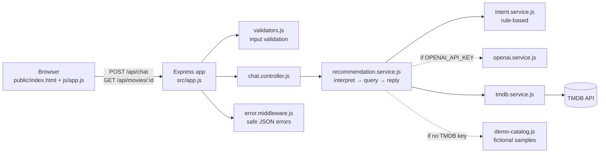

# VIBENT

VIBENT is a conversational movie recommendation chatbot. You describe what you feel like watching in plain English, for example *"sci-fi movies released after 2015"*, *"I'm bored, suggest something interesting"*, or *"movies like Inception"*. VIBENT turns that into a structured search, fetches real results from [TMDB](https://www.themoviedb.org/), and replies in a chat with movie cards.

## Features (MVP)

- **Chat interface.** A dark, responsive chat UI with message bubbles, suggested prompts, a typing indicator, error messages with retry, and a "New chat" reset. It works on desktop and mobile.
- **Natural-language interpretation.** The interpreter picks out genres, moods, years or year ranges ("after 2015", "90s", "between 2000 and 2010"), rating preferences ("highly rated", "rated above 7"), popularity, title searches, and "movies like *X*".
  - **Rule-based by default.** Keyword and regex matching in [`src/services/intent.service.js`](src/services/intent.service.js). This is not an AI model.
  - **Optional OpenAI.** If `OPENAI_API_KEY` is set, OpenAI converts the message into the same structured filters. Its output is validated, and VIBENT falls back to the rules if the call fails. The model only picks search parameters; every movie shown comes from TMDB.
  - Each reply shows which interpreter was used ("Parsed by rules" or "Parsed by OpenAI") and the filters it applied.
- **TMDB integration.** Covers discovery by genre, year, rating and sort; title search; recommendations for a given title; and movie details. It uses request timeouts, safe error messages, and a 10-minute in-memory response cache.
- **Recommendation cards.** Each card shows the poster, title, year, rating, a short overview, and a link to the TMDB page. Clicking a card opens a details dialog with runtime, tagline and genres.
- **Follow-ups.** "Show me more" pages through further results for the previous request. Conversation history lives in the browser tab only.
- **Demo mode.** Without a TMDB key, VIBENT serves a small set of fictional sample titles so the UI can be tried. Demo mode is clearly labelled in the header, in a banner, and on every reply. It is never presented as TMDB data.

## Architecture



1. The frontend sends `{ "message": "...", "context": <paging context or null> }` to `POST /api/chat`.
2. The message is validated: a non-empty string of at most 500 characters.
3. The recommender interprets the message into filters, using OpenAI if configured and rules otherwise.
4. The catalog (TMDB, or demo data when no key is set) is queried with those filters.
5. The reply text is built from templates using the filters and the movies actually returned, so the bot never describes movies it didn't retrieve.

Example response:

```json
{
  "success": true,
  "message": "Here are some sci-fi movies released 2016 or later you might enjoy.",
  "movies": [
    {
      "id": 123,
      "title": "Example Movie",
      "overview": "Movie description",
      "release_date": "2020-01-01",
      "rating": 8.2,
      "vote_count": 5400,
      "poster_path": "/example.jpg",
      "poster_url": "https://image.tmdb.org/t/p/w342/example.jpg",
      "genres": ["Science Fiction"],
      "tmdb_url": "https://www.themoviedb.org/movie/123"
    }
  ],
  "interpretation": { "kind": "discover", "genres": ["Science Fiction"], "year_from": 2016, "sort_by": "popularity.desc" },
  "interpreter": "rules",
  "source": "tmdb",
  "next": { "filters": { "...": "..." }, "page": 1, "offset": 8 },
  "suggestions": []
}
```

Errors use `{ "success": false, "error": { "code": "...", "message": "..." } }` with an appropriate status code:

| Code | Status | Meaning |
|---|---|---|
| `EMPTY_MESSAGE` | 400 | Message was empty or whitespace only |
| `INVALID_REQUEST` | 400 | Body or context was malformed |
| `INVALID_JSON` | 400 | Body was not valid JSON |
| `TMDB_AUTH_FAILED` | 502 | TMDB rejected the API key |
| `TMDB_UNAVAILABLE` | 502 | TMDB returned an error or couldn't be reached |
| `TMDB_RATE_LIMITED` | 503 | TMDB is rate-limiting requests |
| `TMDB_TIMEOUT` | 504 | TMDB took too long to respond |
| `RATE_LIMITED` | 429 | More than 60 API requests per minute from one client |

API keys, stack traces and upstream error bodies are never sent to the client.

### API endpoints

| Method | Path | Purpose |
|---|---|---|
| `POST` | `/api/chat` | Chat message → reply plus movies |
| `GET` | `/api/movies/:id` | Movie details (runtime, tagline, genres) |
| `GET` | `/api/health` | `{ status, source: "tmdb" \| "demo", interpreter: "rules" \| "openai" }` |

## Tech stack

- **Backend:** Node.js (≥ 20) and Express 5, using `helmet` (security headers and CSP), `express-rate-limit`, and `dotenv`. Outbound HTTP uses Node's built-in `fetch` with `AbortSignal.timeout`.
- **Frontend:** plain HTML, CSS and JavaScript served by Express. No build step.
- **Data:** TMDB API v3.
- **Optional:** OpenAI Chat Completions API for message interpretation.
- **Tests:** Jest and Supertest, with all external HTTP mocked.

## Project structure

```
src/
  index.js                      Entry point: loads .env, validates config, starts the server
  app.js                        Express app factory (middleware, routes, static files)
  config.js                     Environment variable parsing and validation
  routes/chat.routes.js         /api/chat and /api/movies/:id
  controllers/chat.controller.js
  services/
    recommendation.service.js   Orchestrates interpret → fetch → reply
    intent.service.js           Rule-based message interpretation
    openai.service.js           Optional OpenAI interpretation
    tmdb.service.js             TMDB client (discover, search, recommendations, details, cache)
    demo-catalog.js             Fictional sample data for demo mode
    genres.js                   TMDB genre IDs
  middleware/error.middleware.js
  utils/                        validators, errors, logger
public/
  index.html, css/styles.css, js/app.js, favicon.svg
tests/
  chat.test.js, tmdb.test.js, intent.test.js, openai.test.js, helpers.js
```

## Getting started

### Prerequisites

- Node.js 20 or newer (tested on Node 26) and npm
- A free TMDB account for live data. Without one, VIBENT runs in demo mode.

### Get a TMDB API key

1. Create an account at [themoviedb.org](https://www.themoviedb.org/signup) and verify your email.
2. Go to **Settings → API** ([themoviedb.org/settings/api](https://www.themoviedb.org/settings/api)) and request an API key (developer / personal use).
3. Copy either the **API Key** (v3) or the **API Read Access Token** (v4). VIBENT accepts both and detects which one you provided.

### Install and configure

```bash
npm install
```

```bash
cp .env.example .env
```

Then edit `.env` and set `TMDB_API_KEY=<your key>`. `OPENAI_API_KEY` is optional.

### Run

```bash
npm start
```

Open http://localhost:3000. The header shows **Live TMDB** when a key is configured, or **Demo data** otherwise. For auto-restart on file changes, use `npm run dev` (`node --watch`).

### Test

```bash
npm test
```

For a coverage report:

```bash
npm run test:coverage
```

The tests cover valid chat requests, empty and invalid input, malformed JSON, TMDB success, failures (5xx, 401, 429, timeout, network, bad JSON) and empty results, paging and caching, demo mode, the details endpoint, the OpenAI interpreter and its fallback, and intent extraction. All TMDB and OpenAI calls are mocked, so no network access or keys are needed.

## Environment variables

| Variable | Required | Default | Description |
|---|---|---|---|
| `PORT` | no | `3000` | HTTP port |
| `TMDB_API_KEY` | recommended | none | TMDB v3 API key or v4 read token. Empty means demo mode. |
| `OPENAI_API_KEY` | no | none | Enables OpenAI interpretation |
| `OPENAI_MODEL` | no | `gpt-4o-mini` | Model used when OpenAI is enabled |
| `TMDB_TIMEOUT_MS` | no | `8000` | TMDB request timeout |
| `OPENAI_TIMEOUT_MS` | no | `10000` | OpenAI request timeout |
| `TRUST_PROXY` | no | `false` | Set `true` behind a reverse proxy |

## Known limitations

- **Movies only.** Requests for books, games, music, events or travel are politely declined.
- **Simple rule-based parsing.** The default interpreter is keyword matching. It handles common phrasings but not complex or negated requests ("anything but horror"). The rules also don't resolve follow-ups like "older ones" against the previous request; only "show me more" is understood. Setting `OPENAI_API_KEY` helps with phrasing, but follow-ups still work the same way.
- **No persistence.** Conversation history lives in the browser tab and is lost on reload. There are no user accounts or saved preferences.
- **Single process.** The response cache and rate limiter are in memory, per server process.
- **English only.** Queries and TMDB results use `en-US`.
- **OpenAI path tested with mocks only.** It hasn't been run against the live OpenAI API. The default model name may need updating in `OPENAI_MODEL`.
- **Outdated docs.** `IMPLEMENTATION.md`, `PROJECT_STATUS.md` and `ZOHO_CLIQTRIX_SUBMISSION.md` describe an earlier, unimplemented design (Eventbrite, Amadeus, Spotify, OAuth, SalesIQ) and do not reflect this codebase.

## Attribution

Movie data and images are provided by [TMDB](https://www.themoviedb.org/). This product uses the TMDB API but is not endorsed or certified by TMDB.

## License

MIT. See [LICENSE](LICENSE).
